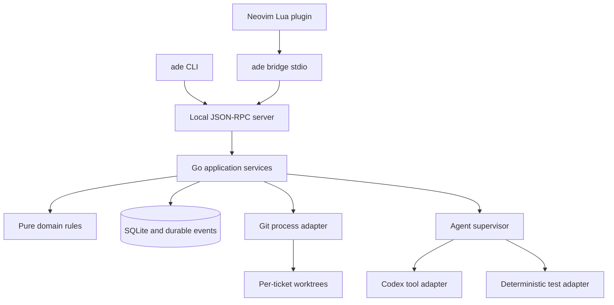

# Architecture

## Selected stack

**Go Core, Go CLI, Lua Neovim plugin.** Start with Go 1.26 as the baseline toolchain; ADE-001 pins a supported patch release and dependency versions. Use the standard library for contexts, processes, JSON, networking, logging, flags, and tests. Use `database/sql` with `modernc.org/sqlite` for SQLite without CGO. Check its Go/platform compatibility during bootstrap; changing the driver requires a decision-record update. Avoid an ORM, service framework, JavaScript runtime, message broker, or separate database server.

Build one `ade` executable with `daemon`, `bridge`, and user commands. A single per-user daemon owns SQLite and orchestrates all open projects. Neovim launches `ade bridge --stdio` using `jobstart`; the bridge forwards framed JSON-RPC to the daemon's local socket. The CLI calls the same RPC. Clients contain rendering/navigation and no domain transitions.



This is a modular monolith. There are no network services inside Core and no event-sourced aggregate reconstruction. Persist current rows plus a durable event log/outbox in one transaction. Events deliver updates and trigger recoverable background jobs; the database remains authoritative.

## Proposed implementation layout

```text
cmd/ade/                      # executable and subcommand wiring
internal/domain/              # types, transition guards, queue ordering; no I/O
internal/application/         # use cases and ports; transactions, orchestration
internal/store/sqlite/        # SQL migrations, repositories, event/job storage
internal/transport/rpc/       # versioning, framing, methods, errors, subscriptions
internal/transport/local/     # Linux sockets; platform-specific files
internal/adapter/git/         # argv-based Git, worktrees, snapshots, integration
internal/adapter/provider/   # registry, fake, Codex tool protocol adapter
internal/runner/              # process supervision, tests, logs, cancellation
internal/config/              # local settings, validation, path discovery
internal/cli/                 # flags, JSON/text output; calls RPC
plugin/ade.lua                # lightweight Neovim entry point
lua/ade/                     # transport, state cache, commands, views, mappings
tests/integration/            # Git/SQLite/RPC and restart tests
tests/e2e/                    # fake-provider headless and Neovim journey
Docs/                        # these design documents and evidence
specs/                       # contracts, tickets, backlog, fixtures
```

Dependencies point inward: domain imports standard library only; application imports domain and declares interfaces; adapters implement ports. Startup wiring may import all layers. Application must not import Neovim, Codex SDK details, SQL driver types, or shell-specific logic. Keep ports small around actual MVP needs; do not build a generic plugin platform.

## Ownership and concurrency

One daemon holds an OS lock on its data directory. SQLite uses WAL, foreign keys, busy timeout, explicit migrations and serialized short write transactions. All mutations use optimistic `expected_version`; stale clients receive `CONFLICT` and refetch. Background jobs carry idempotency keys and persistent states. Never hold a database transaction while waiting for Git, a provider, or a test process.

Each ticket has a separate development worktree; validations use an immutable candidate checkout in a separate validation worktree. ADE grants one development write lease per ticket to either developer or human, never both. Each repository has one integration lease. Leases include a persisted monotonically increasing fence and owner; a timeout never authorizes a second writer until the old process is confirmed stopped. Cross-project work proceeds independently. External editors and Git processes can bypass ADE: detect unexpected HEAD/worktree changes and stop writes. This is coordination, not OS sandboxing.

## Durable state and files

Use XDG config/data/state/runtime directories on Linux, with environment overrides for tests. Store local settings under `$XDG_CONFIG_HOME/ade/config.json`, database and worktrees under `$XDG_DATA_HOME/ade`, and logs/artifacts under `$XDG_STATE_HOME/ade`. Respect XDG fallback paths. Use a short socket path in a private runtime directory; if `XDG_RUNTIME_DIR` is absent, use a private user-owned directory under the state root and enforce socket path length. Never put operational secrets, SQLite, worktrees, or installation settings in the project repository.

Canonical repository root plus common Git directory identify a project locally, including linked worktrees. Persist a UUID project ID and user-visible display name. A second clone is a separate project; reopening a linked worktree of the same common Git directory resolves to the existing project. Moving a repository needs explicit `project.relocate`, which checks the common Git identity and pauses active runs before updating paths. Initial MVP may return `UNSUPPORTED` for relocation and require re-registration after manually exporting useful ticket data; do not silently attach an old project ID to an unrelated directory.

Artifacts have relative paths and checksums in the DB, but RPC exposes artifact IDs with bounded reads, never arbitrary path access. Full provider output goes to bounded/rotated artifact files; durable chat/status rows are separate. Provider-specific resume references are optional metadata. Human-approved review comments and summaries persist regardless of provider resumption support.

## Interfaces and extension points

[RPC](../specs/contracts/rpc.md) is the stable frontend boundary. [Provider ports](../specs/contracts/provider.md) isolate tool integration. [Git contracts](../specs/contracts/git.md) isolate process and filesystem mechanics. Queue policy, branch template, validation commands, provider profiles, and keymaps are configurable with schema validation. New providers are Go adapters registered at compile time for MVP; an external protocol can follow later without changing tickets.

Linux is the release target. Keep process signaling and local sockets in platform files, use `filepath`, avoid shell pipelines and `/bin/sh` assumptions, and test paths with spaces. macOS and Windows require adapter/permission validation before being advertised. The wire protocol and Neovim plugin remain unchanged when another local transport is added.
